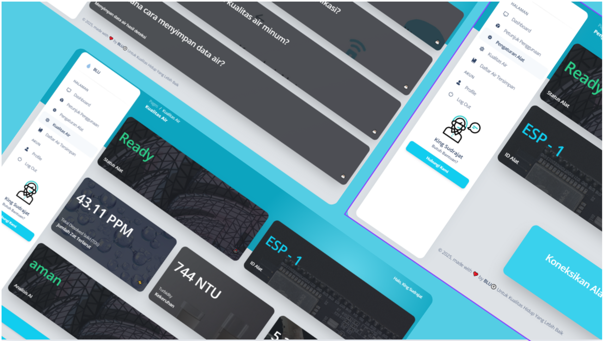
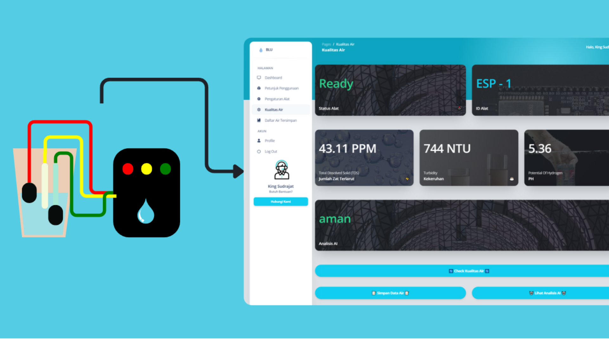
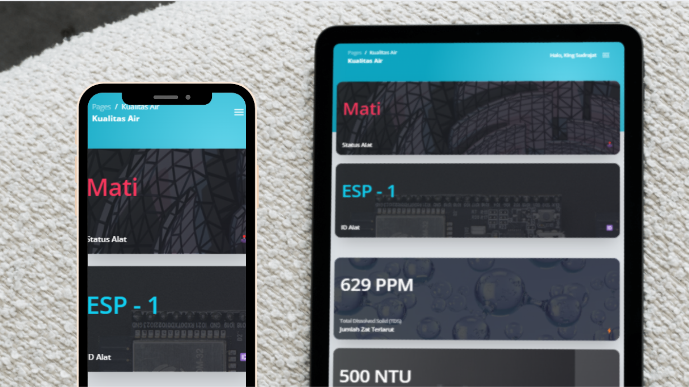
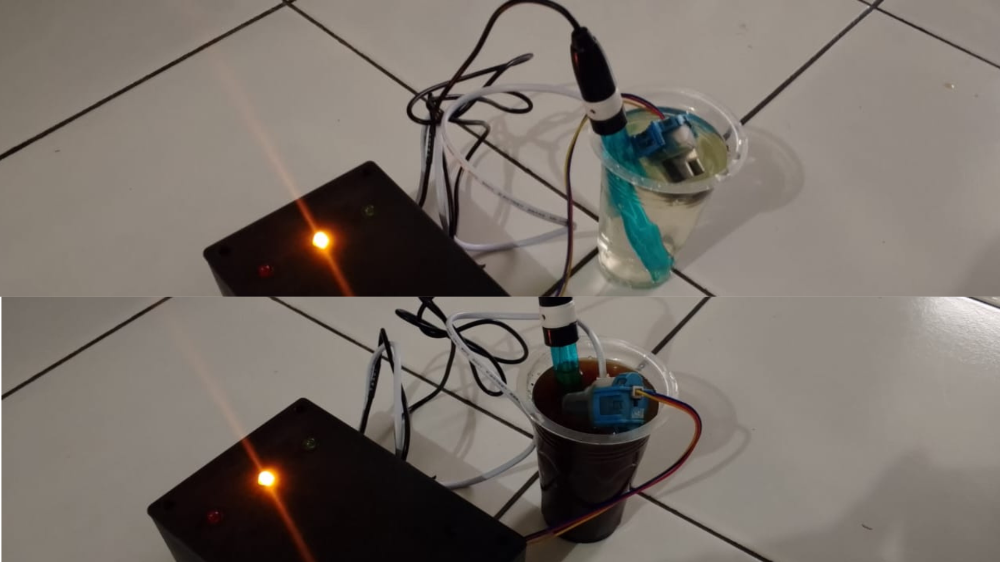
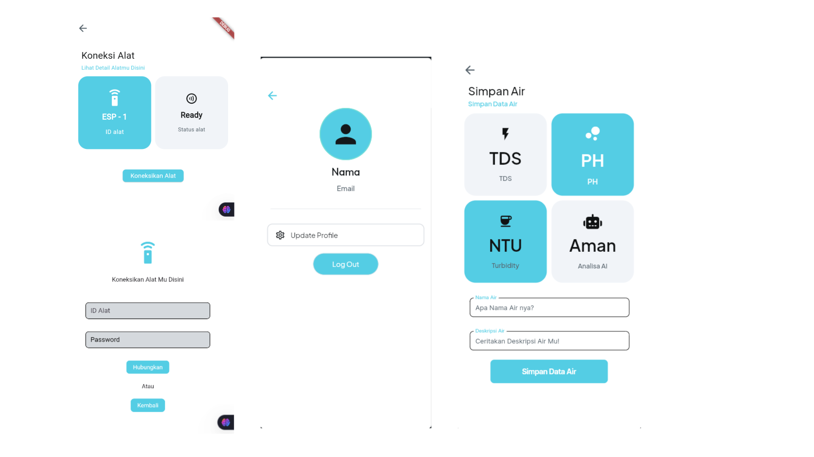

<div align="center">

# BLU

**IoT-based water quality monitoring with fuzzy AI analysis.**
*For a better quality of life.*




</div>

---

## Table of Contents

- [About](#about)
- [How It Works](#how-it-works)
- [Features](#features)
- [Screenshots](#screenshots)
- [Hardware Prototype](#hardware-prototype)
- [Mobile App](#mobile-app)
- [AI Analysis (Fuzzy Logic)](#ai-analysis-fuzzy-logic)
- [Tech Stack](#tech-stack)
- [Project Structure](#project-structure)
- [Getting Started](#getting-started)
- [Usage](#usage)
- [Disclaimer](#disclaimer)
- [Author](#author)
- [Credits](#credits)
- [License](#license)

---

## About

BLU is a water quality monitoring system built as a **final project for the Web Programming course (Group 10)**. A sensor device measures three water parameters, **TDS**, **turbidity**, and **pH**, and sends them to a web dashboard and a mobile app. A fuzzy-logic analysis then classifies the water so users can understand the result without reading raw sensor numbers.

Households that rely on well or refill water and have no easy way to check it can use BLU to monitor the quality of their water. Furthermore, BLU was created to resolve confusion regarding which water standards should be applied. BLU utilizes two global standards, which are integrated using a fuzzy logic approach. 

---

## How It Works



1. **Sense.** Probes placed in a water sample measure TDS, turbidity, and pH.
2. **Transmit.** The ESP32-based device sends readings to the BLU backend via HTTP.
3. **Analyze.** The fuzzy logic engine produces a quality category and a crisp score.
4. **Display.** Results appear on the web dashboard and in the mobile app.
5. **Save.** Users can store a reading with a name and description for later comparison.

---

## Features

- **Live sensor readings**: TDS (ppm), turbidity (NTU), and pH on one dashboard.
- **AI analysis**: water classified into quality categories using fuzzy logic.
- **Device status**: shows the device ID and whether it is `Ready` or off (`Mati`).
- **Saved water records**: store a reading with a name and description, then browse the list.
- **Device settings and pairing**: connect a device using its ID and password.
- **Usage guide**: built-in FAQ explaining how to save data and read results.
- **User accounts**: login, profile, and logout.
- **Responsive UI**: works on desktop, tablet, and phone.
- **Physical LED indicators** on the device (red / yellow / green). Red means Dangerous, Yellow means Warning / Potentially Dangerous and Green means Good.
---

## Screenshots

### Responsive web dashboard



### Dashboard pages

| Page | Preview |
|---|---|
| Login | [Screenshot of login page] |
| Water quality dashboard | [Screenshot of dashboard with realistic readings] |
| Saved water list | [Screenshot of saved water list] |
| Device settings | [Screenshot of device settings page] |
| Usage guide | [Screenshot of usage guide page] |

---

## Hardware Prototype

The prototype is a sensor box with LED indicators, connected to probes placed in the water sample.



**Components** 

| Part | Model |
|---|---|
| Microcontroller | ESP32 |
| TDS sensor |
| Turbidity sensor |
| pH sensor | 
| Indicators | 3 LEDs (red, yellow, green) |

---

## Mobile App

A companion mobile app lets users pair a device, view its status, and save water readings.



| Screen | Purpose |
|---|---|
| Device connection | Shows device ID and status, with a "Connect Device" action |
| Pair device | Enter device ID and password to connect |
| Save water | Pick TDS / pH / turbidity / AI result, then add a name and description |
| Profile | View account details, update profile, log out |

BLU Mobile Version : https://github.com/Subarjox/BLU-Mobile

---

## AI Analysis (Fuzzy Logic)

The "AI Analysis" card on the dashboard is produced by a fuzzy inference process that turns TDS, turbidity, and pH into a single quality category and a crisp (defuzzified) score.

**Input variables and ranges**: Two variables, WAWQI and IKA. Both operate on a universe of discourse (range) from 0 to 100.

**Membership functions**: Uses a combination of Trapezoidal (trapmf) for the extreme boundary sets (like 'excellent' or 'sangat_baik') and Triangular (trimf) for the intermediate sets (like 'good', 'buruk').

**Rule base**: There are exactly 20 explicit rules. Example rule: IF WAWQI is 'excellent' AND IKA is 'sangat_buruk' THEN Hasil is 'bahaya'.

**Inference and defuzzification method**: The system uses Mamdani inference with Centroid defuzzification (which is the default mathematical method used by the skfuzzy.control module when compute() is executed).

**Output categories and their score ranges**: aman (safe, score > 70), hati-hati (caution, score 51 - 70), and bahaya (danger, score <= 50).

The implementation lives in [`fuzzy/`](fuzzy/).

---

## Tech Stack

| Layer | Technology |
|---|---|
| Web backend | PHP 8.0 |
| Database | MySQL |
| Web frontend | HTML, CSS, JavaScript, Bootstrap 5 |
| UI template | [Argon Dashboard](https://github.com/creativetimofficial/argon-dashboard) v2.1.0 by Creative Tim |
| Build tools | Gulp 5, Sass |
| IoT device | ESP32, TDS + turbidity + pH sensors |
| Mobile app |Flutter |
| CI | GitHub Actions (`.github/workflows`) |

---

## Project Structure

```
BLU/
├── .github/workflows/   # 
├── assets/              # CSS, JS, images, fonts (Argon base + BLU assets)
├── classes/             # PHP classes, e.g. DB connection, models, helpers
├── database/            # .sql files / database schema
├── docs/                # Documentation images (and reports, if any)
├── fuzzy/               # Fuzzy logic implementation
├── pages/               # Application pages
├── index.php            # Entry point, redirects to /pages
├── gulpfile.mjs         # Gulp tasks (from the Argon template)
├── package.json
├── CHANGELOG.md
└── LICENSE.md
```

---

## Getting Started

### Prerequisites

- PHP 8.0
- MySQL
- A local web server (XAMPP, Laragon, etc.)
- Node.js and npm (optional, only needed to rebuild SCSS with Gulp)
- The BLU sensor device, if you want live readings

### Installation

1. Clone the repository into your web server's root folder.

   > `index.php` uses `base_url = '/blu/'`, so the project folder **must be named `blu`** (lowercase), or you must change `base_url` in `index.php`.

   ```bash
   cd /path/to/htdocs
   git clone https://github.com/Subarjox/BLU.git blu
   cd blu
   ```

2. Import the database.

   ```bash
   mysql -u root -p your_database blu2.sql
   ```

3. Configure the database connection. 

4. (Optional) Install front-end dependencies:

   ```bash
   npm install
   ```

5. Start your web server and open:

   ```
   http://localhost/blu/
   ```

   You will be redirected automatically to `http://localhost/blu/pages`.
---

## Usage

1. Log in to the dashboard.
2. Pair your device in **Device Settings** using its device ID and password. The status should change to `Ready`.
3. Place the probes in your water sample.
4. Press **Check Water Quality** to read the sensors and run the analysis.
5. Press **Save Water Data** to store the result with a name and description, or **View AI Analysis** for the detailed result.
6. Review saved samples in **Saved Water**.

---

## Disclaimer

BLU is an academic prototype built with low-cost sensors. Readings depend on sensor calibration and are **not certified** for regulatory or health decisions. Do not use BLU as the only basis for deciding whether water is safe to drink.

---

## Author

**Muhamad Fahreza**, software development

- GitHub: @Subarjox

---

## Credits

The web interface is built on [Argon Dashboard](https://www.creative-tim.com/product/argon-dashboard) by [Creative Tim](https://www.creative-tim.com/), released under the MIT license.

---

## License

Released under the [MIT License](LICENSE.md).
